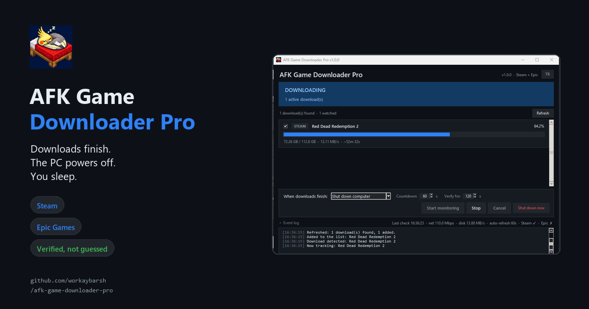

# AFK Game Downloader Pro

Watches your **Steam** and **Epic Games** downloads and powers the PC off when they are
truly finished — so you can queue a 120 GB game and go to sleep.

The hard part is not shutting down; it is *knowing* the download is finished. This app
never guesses.

**Version 1.0.0** · Windows 10/11 · Python 3.10+ (or the standalone `.exe`) · MIT License



---

## What it does

* Finds the downloads that Steam and Epic are currently working on (both sources are always watched).
* Lists them with progress, transfer speed, ETA and the space they occupy on disk.
* Lets you tick/untick which games must finish (only ticked downloads gate the shutdown).
* **Refresh** re-scans the libraries and pulls in anything new or previously ignored.
* Re-scans automatically every 60 seconds, and re-reads progress every 2 seconds.
* When everything ticked is really installed: verifies, waits, counts down, then shuts down
  (or restarts / sleeps / hibernates).

The whole UI switches between English and Turkish with one click (TR/EN button); the choice
is remembered.

---

## Why the signal is trustworthy

A shutdown happens only when **all** of these are true:

1. **A watched download was actually observed.** If the app starts and nothing is downloading
   it waits — "nothing happening" is never treated as "finished".
2. **Every watched app is fully installed.**
   * Steam: `StateFlags` = `Fully Installed` with no `Update Required`/`Downloading`/`Staging`
     bits, `BytesDownloaded` ≈ `BytesToDownload`, **and** Steam's own log state is
     `Fully Installed` with no active words.
   * Epic: `bIsIncompleteInstall` = `false`.
3. **No transfer is still live** (Steam's `Current download rate` line is stale).
4. **The state stays calm for the verification window** (default 120 s), re-checked continuously.
5. **Nothing restarts.** If a ticked download starts again during the countdown, the countdown
   is cancelled and monitoring resumes.
6. **Final re-check.** At the exact moment the countdown ends, the app re-reads every manifest
   and the log from disk one last time. If anything disagrees, the action is cancelled and
   verification starts over.

Only then does it act. Every confirmation is written to the event log together with its proof:

```
[14:45:38] COMPLETED: Red Dead Redemption 2
[14:45:38] Proof: Red Dead Redemption 2: flags=4, 112.6 GB/112.6 GB, log='Fully Installed'
[14:45:38] Action in 60s: Shut down computer
```

Numbers come from the manifests only — no estimates are ever used for a decision.

---

## Install

Run **`AFK Game Downloader Pro Setup.exe`**:

1. Welcome → **Next**
2. Install location (default `%LOCALAPPDATA%\Programs\AFK Game Downloader Pro`, no admin needed)
3. Optional tasks: desktop shortcut, Start Menu shortcut, start with Windows
4. **Install** → progress → **Finish** (optionally launches the app straight away)

The wizard has a TR/EN switch in the top-right corner.

Uninstall from **Settings → Apps → Installed apps**, or run `Uninstall.cmd` in the install
folder. It removes the shortcuts, the auto-start entry and the settings.

## Run without installing

```
Start.vbs      <- double-click (no console window)
Start.bat      <- console version for troubleshooting
```

or directly:

```
python main.pyw
```

Settings live in `%APPDATA%\AFKGameDownloaderPro\config.json`.

---

## Using the app

| Element | Meaning |
|---|---|
| Status banner | waiting → downloading → verifying → completed → action taken |
| Game list | every download found; tick a game to make it gate the shutdown |
| `Refresh` | re-scan libraries, re-add new or ignored downloads |
| Row details | downloaded / total, transfer speed, ETA, space on disk |
| `When downloads finish` | Shut down / Restart / Sleep / Hibernate |
| `Test mode` | dry run: everything happens except the action itself |
| `Countdown` | seconds between "completed" and the action (cancellable) |
| `Verify for` | how long the calm window must last before "completed" is accepted |
| `Event log ▸` | collapsed by default — click the header to open it |
| `TR` / `EN` | switch the whole UI language instantly |

## Console diagnostics

```
python diagnose.py          # one report
python diagnose.py --loop   # live, refreshed every 5 s
python diagnose.py --tr     # Turkish output
```

---

## Build

```
python tools/make_icon.py     # rebuild assets/app.ico from assets/icon_source.png
build_exe.bat                 # -> dist\AFK Game Downloader Pro.exe
build_installer.bat           # -> dist\AFK Game Downloader Pro Setup.exe (bundles the exe)
```

## Tests

```
python test_all.py        # everything below, one summary table
python test_clean_install.py  # real Setup.exe -> install -> launch -> close -> uninstall
python test_logic.py      # 41 checks: decision engine (never act unless proven)
python test_ui.py         # window builds, language toggle, log collapse, row rendering
python test_installer.py  # 19 checks: install, icons, shortcuts, launch, uninstall
python check_language.py  # no localized text outside afkdl/i18n.py
```

`test_logic.py` covers: normal completion, a download resuming during verification, missing
bytes, a live transfer rate, no download at all, cancel, a vanished manifest, a log state that
disagrees with the manifest, the final re-check cancelling the action, Stop/Cancel, un-ticking a download,
Steam disappearing mid-verification, and the raw Steam state-parsing rules.

## Layout

```
afkdl/            application package
  detector.py     decision engine (the safety rules live here)
  steam.py        Steam detection: content_log.txt + appmanifest_*.acf + process IO
  epic.py         Epic detection: *.item manifests + launcher log
  ui.py           Tkinter UI
  i18n.py         English + Turkish strings
  power.py        shutdown / restart / sleep / hibernate
setup_tool/       installer wizard + Windows install operations
installer.pyw     setup entry point
main.pyw          application entry point
assets/           icon and in-app artwork
tools/            icon builder, icon checker, window capture helper
```

## Known limitations

* Steam and Epic must stay logged in while downloads run.
* If Steam is closed mid-download the app will not shut down — a closed client is not a
  finished download.
* Steam flushes `appmanifest` infrequently, so the byte counters can lag behind the real
  transfer; the app deliberately shows only what the manifest states.
* Epic does not expose a percentage, so its progress is shown as unknown.
* Sleep/Hibernate need the usual Windows power settings to be enabled.

---

## License

Released under the [MIT License](LICENSE).

Copyright (c) 2026 AFK Game Downloader Pro contributors.
